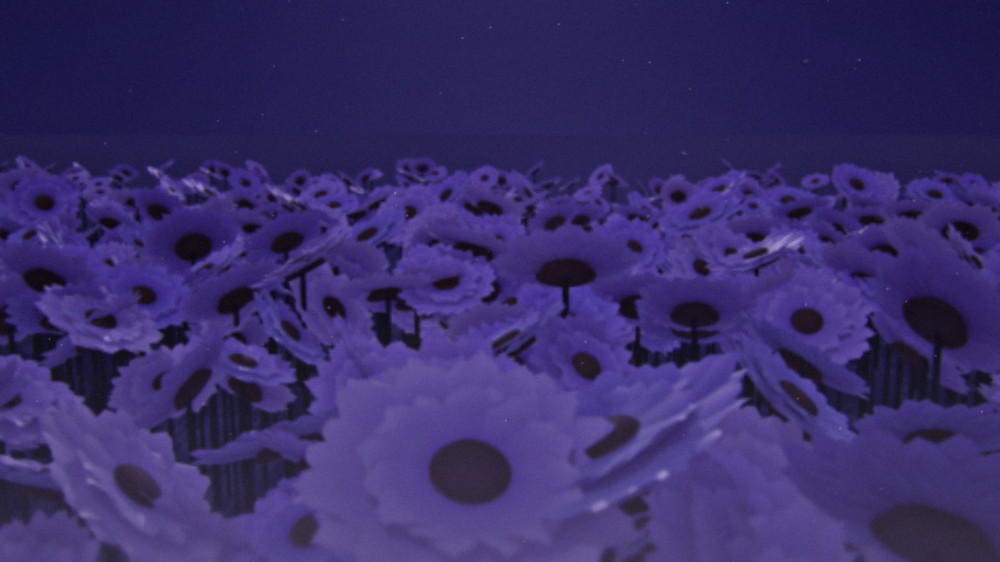
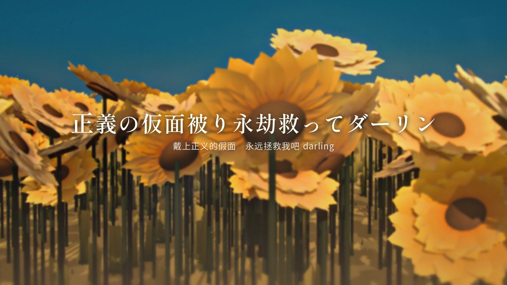
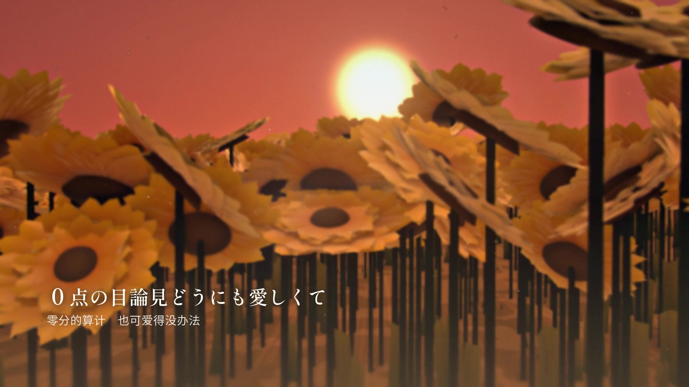
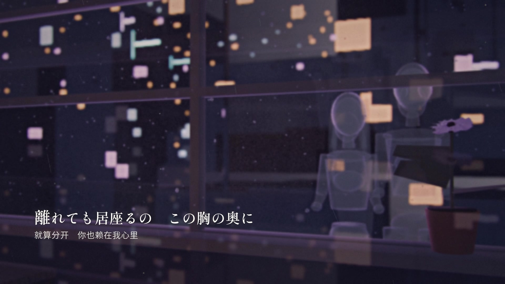
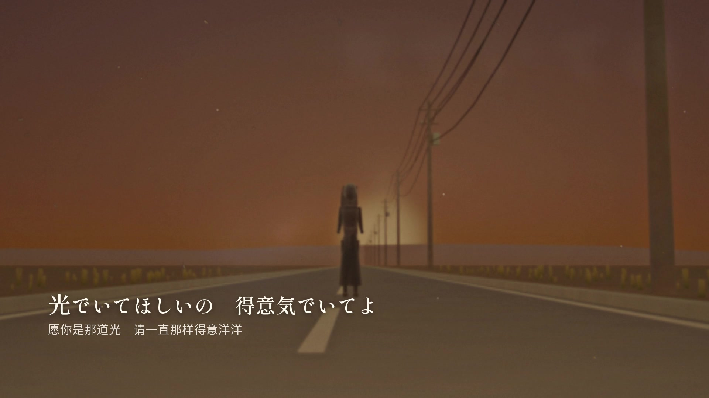

# 紫色の向日葵 — MV

> 一首日文歌曲《紫色の向日葵》的完整 MV（4 分 33 秒 / 1080p / 57 个镜头），从歌词解读、分镜、3D 场景、合成调色到歌词排版，全部由 AI Agent 团队协作完成；本仓库是这支 MV 的**完整制作工程**：Blender 场景生成脚本 + Python 逐帧合成管线 + 歌词排版系统 + 时间轴/分镜数据。

**English** — A complete music video for the Japanese song *"Purple Sunflower" (紫色の向日葵)* by 香椎モイミ feat. 羽累. Everything — concept, 57-shot storyboard, procedural Blender scenes, per-frame compositing, bilingual lyric typography — was produced by an AI agent team. This repo contains the full production pipeline (Blender + Python + FFmpeg), not the copyrighted music/lyrics.

## ⬇️ 看成片

**[▶ 下载 / 观看成片 v1.0.0（Release）](https://github.com/gaowanproject/purple-sunflower-mv/releases/tag/v1.0.0)**

| Release 附件 | 说明 |
|---|---|
| [`purple_sunflower_MV_1080p.mp4`](https://github.com/gaowanproject/purple-sunflower-mv/releases/download/v1.0.0/purple_sunflower_MV_1080p.mp4) | 成片 1920×1080 / 24fps / 179.8 MB |
| [`purple_sunflower_MV_preview360p.mp4`](https://github.com/gaowanproject/purple-sunflower-mv/releases/download/v1.0.0/purple_sunflower_MV_preview360p.mp4) | 360p 低码预览（13 MB） |
| [`purple_sunflower_MV_poster.png`](https://github.com/gaowanproject/purple-sunflower-mv/releases/download/v1.0.0/purple_sunflower_MV_poster.png) | 海报帧 1920×1080 |



---

## 成片

| | |
|---|---|
| 时长 | 4:32.96（272.966s / 6551 帧 @ 24fps） |
| 画面 | 1920×1080 / 24fps / H.264 High (CRF18, faststart) |
| 音频 | AAC 320 kbps / 44.1 kHz / stereo |
| 镜头 | 57 个，全程序化 3D 渲染 + 逐帧合成 |
| 版本 | v1 |

> ⚠️ **本仓库的 git 历史不含音频与歌词原文** —— 音乐与歌词版权归原作者 香椎モイミ / 羽累 所有，本项目是**非商业同人二创**。成片（含音乐）只作为 Release 附件发布，可随时根据版权方要求下架；想自己生成，请自备正版音源与歌词（见 [story/README.md](story/README.md)）。

|  |  |
|---|---|
|  |  |

---

## 一、创作概念

这首歌并不是普通的失恋歌，而是**「明知是幻觉，仍请求被欺骗」**的歌：

- 歌者用造作的语气说"我们不会再见面了"，却又承认"我其实知道你在期待"；
- 核心意象是**「紫色的向日葵」**：向日葵永远朝着太阳转，而紫色在自然界并不存在——
  这份爱只开在记忆里；
- 副歌里反复出现「騙してよ（骗我吧）」「救ってよ（救我吧）」，她要的不是真相，
  而是一个愿意戴上"正义面具"来拯救她的幻觉；
- 副歌第二次变奏从「永劫」变成「厭世」——**爱逐渐变成求生**；
- 桥段是全曲最暗的地方：一个人在凌晨两点把这一切吞下去；
- 最后一句不是释怀，是把这份爱**喊出来又咽回去**。

因此全片由两个色彩世界对切：

| | 金色世界（记忆里的夏天） | 紫色世界（现实与幻觉） |
|---|---|---|
| 色彩 | 过曝暖金、青蓝天空、太阳直射 | 紫罗兰、冷蓝、雨、雾、月色 |
| 光照 | 逆光、热浪、尘埃、光晕 | 冷光、霓虹、残光、微光 |
| 镜头 | 低机位、穿过花田、手持感 | 静止长焦、雨窗、空房间 |
| 情绪 | 温柔、眩晕、不可靠 | 孤独、清醒、仍在自欺 |

**贯穿母题**：向日葵（摇摆 → 牵手 / 凝视）、太阳（光 → 残光 → 月光）、
水（泼在路面的冷水 → 雨 → 融化的冰 → 眼泪）、紫色（干花 → 幻觉中的花 → 夜里的花田）。

人物全片**只以剪影 / 逆光轮廓出现，不露脸**——保留想象空间，让情绪更抽象。

### 结构（57 镜）

| 段落 | 时间 | 内容 |
|---|---|---|
| Intro | 0:00–0:18 | 雨窗、书桌、干枯的紫色向日葵 → 光溢出 |
| Verse 1 | 0:18–0:35 | 烈日公路、泼在路面的冷水、"笨蛋"、哭泣 |
| Pre-Chorus | 0:35–0:52 | 水花微距、温暖的话语、第一次知道柔软 |
| Chorus 1 | 0:52–1:10 | 金色花田、**紫色向日葵第一次出现**（幻觉） |
| Chorus 1b | 1:10–1:27 | 树荫、汗湿手心、逆光、夕阳下的牵手 |
| Verse 2 | 1:27–1:44 | 雨夜街道、地上的红伞、黄昏公路的残光 |
| Verse 2b | 1:44–2:02 | 融冰、窗上水珠、心跳、窗边剪影 |
| Pre-Chorus 2 | 2:02–2:19 | 黄昏花田、暖光融冰、云流、快切蓄力 |
| Chorus 2 | 2:19–2:37 | **紫罗兰风暴花田**、路边剪影、手腕、奔跑 |
| Chorus 2b | 2:37–2:54 | 凌晨两点、暖台灯、融化的冰淇淋、玻璃里的两个倒影 |
| Bridge | 2:54–3:11 | 去饱和城市、空床 / 空街 / 空场、蜷缩剪影、沉入黑 |
| Final Chorus | 3:11–3:28 | 夜空紫色花田、月光下的花、独自一人、光吞没 |
| Final Chorus b | 3:28–3:45 | 记忆闪回、最后的牵手、嘶喊 |
| Outro | 3:45–4:33 | 花瓣升空、俯瞰发光花田、回到雨窗、标题、淡出 |

---

## 二、技术栈

- **Blender 5.2.3 LTS**（EEVEE，命令行后台渲染）：程序化搭建花田 / 公路 / 雨夜街道 / 房间 / 微距玻璃杯等 6 类场景；
- **Python 3.12**（numpy / Pillow）：逐帧合成——调色、光学效果、2.5D 氛围层、歌词排版、转场；
- **FFmpeg**：H.264 / AAC 编码与逐镜头 segment 拼接；
- **数据驱动**：`story/shots.json`（57 镜帧范围与相机说明）、`story/lyrics.json`（歌词时间轴，用户自备）、`comp/edit.json`（转场表）。

### 渲染/合成参数
- 场景渲染 1920×1080 PNG 序列，EEVEE TAA 10–24 samples，AgX；
- 合成 0.15–0.25 s/帧（1080p），全片 6551 帧；
- 编码 libx264 CRF18 / preset slow / yuv420p / `+faststart`，音频 AAC 320k。

---

## 三、仓库结构

```
blender/                 # 3D 场景生成（Blender 5.2）
  lib.py                 #   共享 look-dev 库（天空/太阳/向日葵/相机/雾/渲染）
  character.py           #   剪影人物（程序化网格，支持 stand/walk/run/sit/hold）
  sets_field.py          #   花田（金/紫黄昏/夜空）26 镜
  sets_road.py           #   公路（烈日/黄昏残光/紫色风暴）8 镜
  sets_void.py           #   黑暗花瓣虚空 3 镜
  sets_room.py           #   室内（雨夜/凌晨两点/暗房/微距）13 镜
  sets_street.py         #   雨夜街道（红伞/天桥）4 镜
  STATUS_A.md / STATUS_B.md   # 场景美术的交付与返工记录
comp/                    # Python 合成管线
  common.py              #   路径、字体、ffmpeg、缓存
  timeline.py            #   镜头时间轴、转场读取
  plates.py              #   plate 读取/缺帧回退
  grade.py               #   调色（15 个色彩世界 + 逐镜自动曝光匹配）
  fx.py                  #   bloom/halation/色散/暗角/颗粒/雨/花瓣/尘埃/热浪
  typography.py          #   歌词排版与逐字动画、标题卡、片尾字卡
  composite.py           #   逐帧合成器
  placeholder.py         #   缺 plate 时的程序化占位（仅用于预览）
  render_segments.py     #   逐镜头渲染 segment（多 worker）
  assemble.py            #   无损 concat + 音频合成
  finalize.py            #   全片 QC、海报、低码预览
  edit.json              #   转场与片头片尾表
  lyrics_layout.json     #   每行歌词的版式（横排/竖排/居中）
story/
  shots.json             #   57 镜时间轴（唯一真源）
  build_lyrics.py        #   由你自己的 LRC + 中文翻译生成 lyrics.json
  lyrics.example.json    #   歌词时间轴结构示例（文本留空）
dev/                     # 辅助脚本（质检、抽帧、音频分析）
assets/
  fonts/dl_fonts.py      #   下载所需开源字体（OFL）
docs/                    # 概念说明、海报、剧照
```

---

## 四、如何复现

> 整套流程在 Windows + RTX 4070 Laptop（8GB）上完成；渲染全程命令行。

### 0. 准备

```bash
# Blender 5.2.3 LTS  （命令行用 blender.exe -b）
# Python 3.12 + numpy + Pillow
pip install numpy pillow

# ffmpeg：把 ffmpeg.exe 放到 tools/ffmpeg.exe（或修改 comp/common.py 的 FFMPEG 路径）
# 字体（OFL，需自行下载，约 20MB）：
python assets/fonts/dl_fonts.py      # 写入 assets/fonts/

# 音频（自备正版音源，不要提交到仓库）：
#   assets/audio/song.mp3  →  转换成 wav：
ffmpeg -i assets/audio/song.mp3 -ac 2 -ar 44100 -c:a pcm_s16le assets/audio/song_ff.wav

# 歌词（自备自己的 LRC 与中文翻译，不要提交到仓库）：
#   story/lyrics.lrc        （LRC 时间轴）
#   story/translation.txt   （逐行中文翻译，与 LRC 歌词行一一对应）
python story/build_lyrics.py          # → story/lyrics.json
```

### 1. 渲染 3D plates（`plates/<镜号>/<镜号>_<绝对帧号>.png`）

```bash
Blender=path/to/blender.exe

# 花田（26 镜）
$Blender -b --factory-startup -P blender/sets_field.py -- --shot S12
# 公路（8 镜）
$Blender -b -P blender/sets_road.py -- shot S06
# 黑暗花瓣虚空（3 镜）
$Blender -b -P blender/sets_void.py -- shot S03
# 室内（13 镜）／街道（4 镜）
$Blender -b -P blender/sets_room.py  -- render_missing
$Blender -b -P blender/sets_street.py -- render_street 20
```

镜头表见 `story/shots.json`；`dev/qc_frames.py` 可校验每个镜头的帧号连续性：

```bash
python dev/qc_frames.py            # 全部镜头
python dev/qc_frames.py --missing-only
```

### 2. 合成并出片

```bash
python comp/render_segments.py --workers 4 --crf 18   # 逐镜头合成 → out/segments/
python comp/assemble.py                               # 无损 concat + AAC 合音
python comp/finalize.py                               # QC 报告 + poster.png + preview.mp4
# → out/final/purple_sunflower_MV_v1.mp4
```

单镜头调试：

```bash
# 静帧 look-dev（不渲染整段）
$Blender -b --factory-startup -P blender/sets_field.py -- --shot S12 --test
# 单镜合成
python comp/render_segments.py --shots S12 --workers 1
```

---

## 五、工程笔记（踩过的坑，供参考）

1. **EEVEE 的 World Volume 会吃掉物体的直接光**。同一场景仅开关 world volume，路面亮度 178 → 19，
   且与密度、体积阴影、采样数、光追开关都无关。最终方案是**完全不用体积雾**，改在后期用 2.5D 雾层做空气透视。
2. **天空球的渐变**：`sky_dome` 用 mesh 球时，`Generated` 坐标不是完整 0..1；自定义渐变应改用
   `Geometry.Position / radius`，且亮度要压到 strength≈0.9 才保得住 AgX 下的蓝天与橙色地平线。
3. **相机穿越场景时必须清掉路径上的物体**（`clear_camera_path`），否则镜头会撞进花头。
4. **Blender 5.2 API 变化**：引擎枚举只有 `BLENDER_EEVEE`；VSE 用 `sequence_editor.strips`；
   `image_settings.file_format` 不能设为 FFMPEG（视频编码用 ffmpeg）。
5. **多进程渲染会互相拖慢**：8GB 显存上最多 2–3 个 EEVEE 进程；总吞吐并不比单进程高。

---

## 六、许可与版权

| 内容 | 许可 |
|---|---|
| **代码**（`blender/` `comp/` `story/` `dev/` `assets/fonts/dl_fonts.py`） | **MIT**（见 [LICENSE](LICENSE)） |
| **渲染图 / 海报 / 剧照 / 成片画面** | **CC BY-NC 4.0**（署名 · 非商业） |
| 歌曲音频、歌词 | © **香椎モイミ / 羽累**，本仓库不包含 |
| 字体 | 各字体自身的开源许可（OFL 等），用 `dl_fonts.py` 自行下载 |

本项目是**非商业同人二次创作**，与歌曲版权方无隶属关系。若你使用本工程，请自行取得音乐与歌词的合法使用权。

---

## 七、致谢

- 音乐：**香椎モイミ「紫色の向日葵」feat. 羽累**
- 工具：Blender、FFmpeg、NumPy、Pillow、Google Fonts（Shippori Mincho / Noto Serif JP / Zen Old Mincho / Kaisei Decol / Zen Kaku Gothic New）
- 制作：由 **DeepSeek Harness** 的 AI Agent 团队协作完成（世界观与分镜、3D 场景、合成调色、歌词排版）
